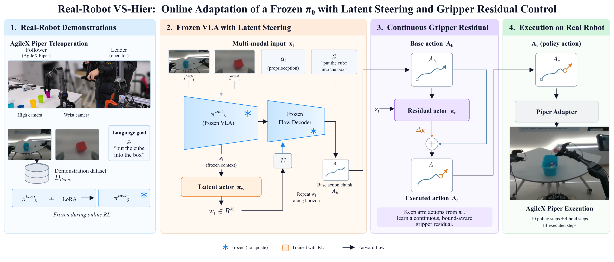
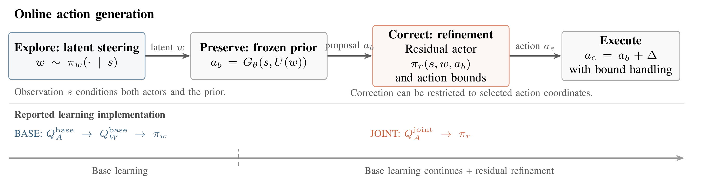
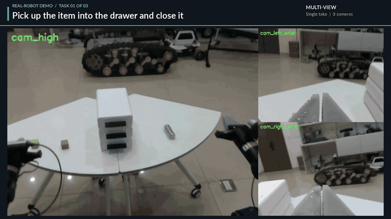
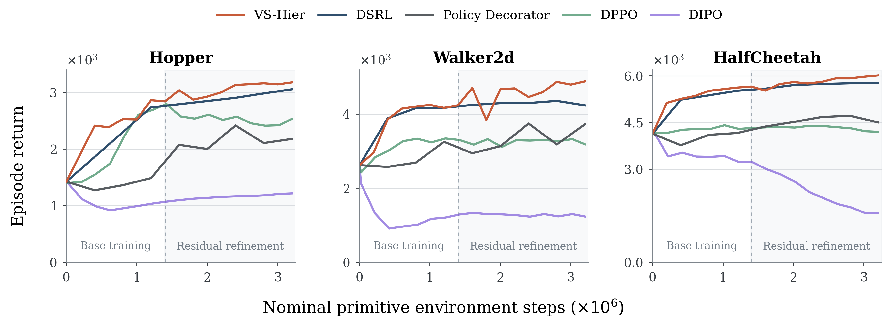

<div align="center">

<h1>VS-Hier</h1>
<h3>Preserve, Explore, and Correct:<br>Hierarchical Online Adaptation of Frozen Generative Policies</h3>

[Method](#method) · [Video](#robot-demonstration) · [Results](#results) · [Usage](https://github.com/knightmell/VS-Hier-Locomotion/blob/main/USAGE.md)

</div>

## Method



**Preserve the prior. Explore through latents. Correct the action.** Train latent steering around a frozen generator, then introduce bounded residual refinement while continuing base learning. Reinforcement-learning updates do not backpropagate through the generator.

<details>
<summary>Locomotion training architecture</summary>



</details>

## Robot demonstration

[](https://github.com/knightmell/VS-Hier-Locomotion/releases/download/v0.1.0/robot_demo.mp4)

6× preview. **[Full video at original speed](https://github.com/knightmell/VS-Hier-Locomotion/releases/download/v0.1.0/robot_demo.mp4)** · 76 seconds.

## Results



Curves show raw episodic return. Final D4RL normalized scores, mean ± SD over three training seeds:

| Task | Matched DSRL | VS-Hier |
|---|---:|---:|
| Hopper | 94.47 ± 1.77 | **98.22 ± 0.24** |
| Walker2d | 92.26 ± 3.66 | **106.39 ± 0.82** |
| HalfCheetah | 48.68 ± 0.35 | **50.72 ± 0.50** |

Budget: **800k action chunks × 4 = 3.2M nominal primitive environment steps**. Scores and curves are from the paper.

## Get started

```bash
git clone https://github.com/knightmell/VS-Hier-Locomotion.git
cd VS-Hier-Locomotion
```

See **[installation, pretrained assets, training and evaluation](https://github.com/knightmell/VS-Hier-Locomotion/blob/main/USAGE.md)**. Task configurations: `hopper`, `walker`, `halfcheetah`.

## Acknowledgments and license

Built on [DSRL](https://github.com/ajwagen/dsrl), [DPPO](https://github.com/irom-princeton/dppo), and [Stable-Baselines3](https://github.com/DLR-RM/stable-baselines3).

Original software: **MIT**. Third-party notices and figure/asset terms: [NOTICE.md](https://github.com/knightmell/VS-Hier-Locomotion/blob/main/NOTICE.md).
